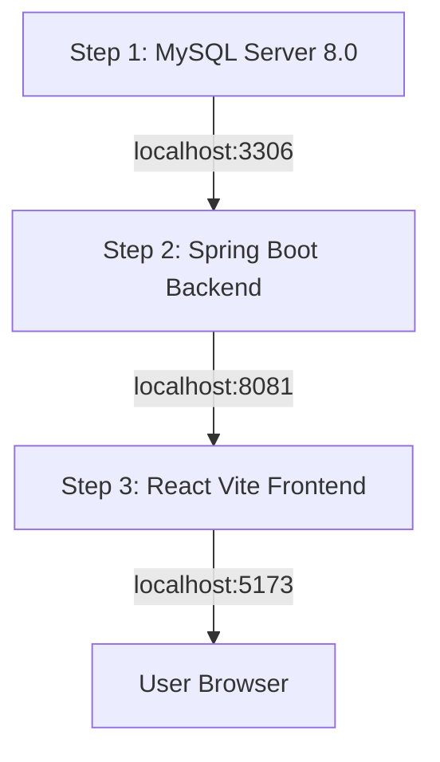

# Master Run Guide: Full-Stack Movie Booking System

This workspace contains a complete full-stack Movie Ticket Booking application comprising a **Spring Boot** backend API and a **React + Vite** frontend.

---

## 1. Architecture & Project Layout

```text
d:\movieweb\
├── backend\
│   └── thirdyearex1\       -> Spring Boot 3.5.4 Backend (Port 8081)
│       ├── pom.xml
│       ├── src\
│       │   └── main\
│       │       ├── java\com\example\thirdyearex1\...
│       │       └── resources\application.properties
│       └── RUN_GUIDE.md
├── MovieBookingWeb\        -> React 19 + Vite Frontend (Port 5173)
│   ├── package.json
│   ├── vite.config.js
│   ├── src\...
│   └── RUN_GUIDE.md
└── RUN_GUIDE.md            -> This Master Orchestration Guide
```

---

## 2. Environment Verification Checklist

Run these commands in PowerShell inside the Antigravity IDE terminal:

```powershell
# 1. Check Java JDK (Requirement: Java 17+)
java -version

# 2. Check Maven (Requirement: 3.9+)
mvn -v

# 3. Check Node.js and npm (Requirement: Node 18+)
node -v
npm -v

# 4. Check MySQL Server
mysql --version
Get-Service -Name MySQL*
```

---

## 3. Required Startup Order

The services **MUST** be started in the following order:



1. **Step 1: MySQL Database**
   - Must be running on port `3306`.
   - Ensure the database `movie_booking` exists.
2. **Step 2: Spring Boot Backend**
   - Runs on port `8081`.
   - Auto-migrates database tables and seeds the default administrator.
3. **Step 3: React Frontend**
   - Runs on port `5173`.
   - Communicates with `http://localhost:8081` using JWT bearer tokens.

---

## 4. Step-by-Step Execution Guide

### Terminal 1: Start the Backend (Spring Boot)

```powershell
# 1. Navigate to the backend directory
cd d:\movieweb\backend\thirdyearex1

# 2. Run the Spring Boot application
mvn spring-boot:run
```

*Wait until you see:*
```text
Tomcat started on port 8081 (http) with context path '/'
Started Thirdyearex1Application in X.XXX seconds
Admin already exists. (or ADMIN CREATED)
```

---

### Terminal 2: Start the Frontend (Vite)

Open a second terminal tab in Antigravity IDE:

```powershell
# 1. Navigate to the frontend directory
cd d:\movieweb\MovieBookingWeb

# 2. Start the Vite development server
npm run dev
```

*Wait until you see:*
```text
  VITE v8.2.0  ready in ... ms

  ➜  Local:   http://localhost:5173/
```

---

## 5. Verification & Testing

### 1. Web Application Access
Open your web browser and navigate to:
```text
http://localhost:5173
```

### 2. Administrator Access
Log in with the seeded credentials:
- **Email**: `admin@gmail.com`
- **Password**: `admin123`
- Navigate to the Admin Dashboard: `http://localhost:5173/admin`

### 3. API Health Check (PowerShell)
You can test the backend directly using PowerShell:
```powershell
# Authenticate
$auth = Invoke-RestMethod -Uri "http://localhost:8081/auth/login" `
  -Method Post `
  -ContentType "application/json" `
  -Body '{"email":"admin@gmail.com","password":"admin123"}'

# Fetch Movies
Invoke-RestMethod -Uri "http://localhost:8081/movies" `
  -Method Get `
  -Headers @{ Authorization = "Bearer $($auth.token)" }
```

---

## 6. How to Stop Everything

1. **Stop Frontend**: In Terminal 2, press `Ctrl + C`, then press `Y` and Enter.
2. **Stop Backend**: In Terminal 1, press `Ctrl + C`.
3. To kill any remaining processes holding the ports:
```powershell
# Free port 8081 (Backend)
Get-NetTCPConnection -LocalPort 8081 -ErrorAction SilentlyContinue | ForEach-Object { Stop-Process -Id $_.OwningProcess -Force }

# Free port 5173 (Frontend)
Get-NetTCPConnection -LocalPort 5173 -ErrorAction SilentlyContinue | ForEach-Object { Stop-Process -Id $_.OwningProcess -Force }
```
